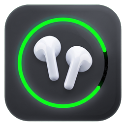
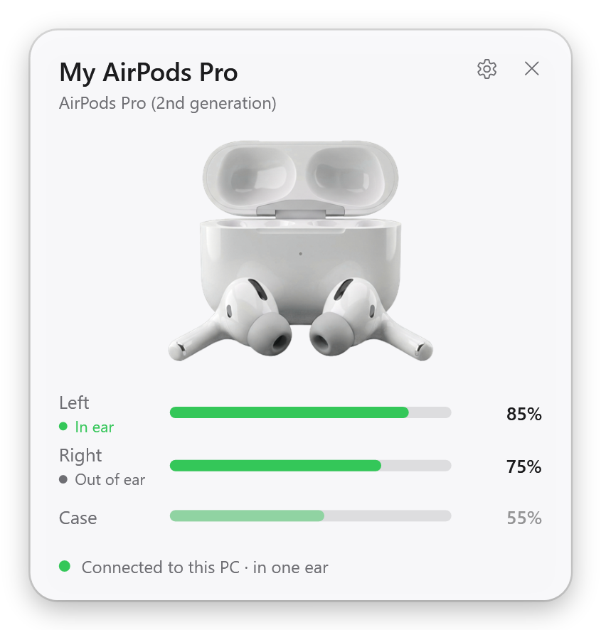
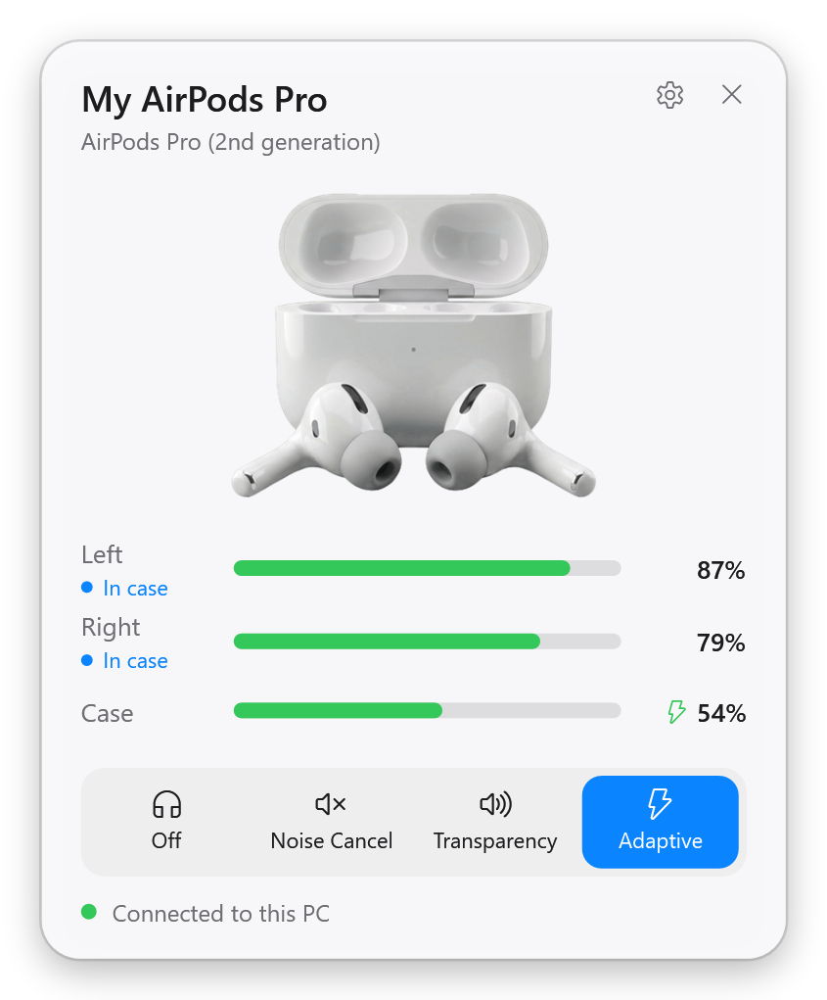
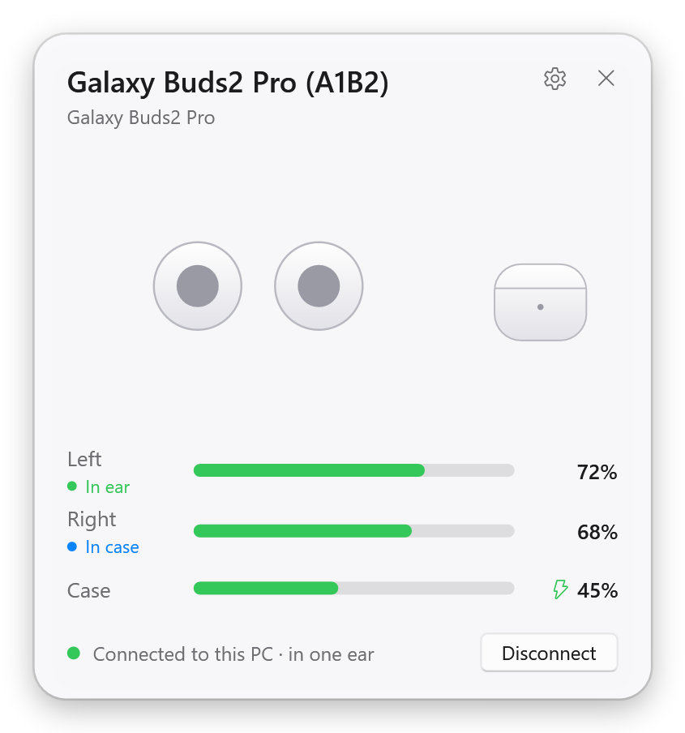
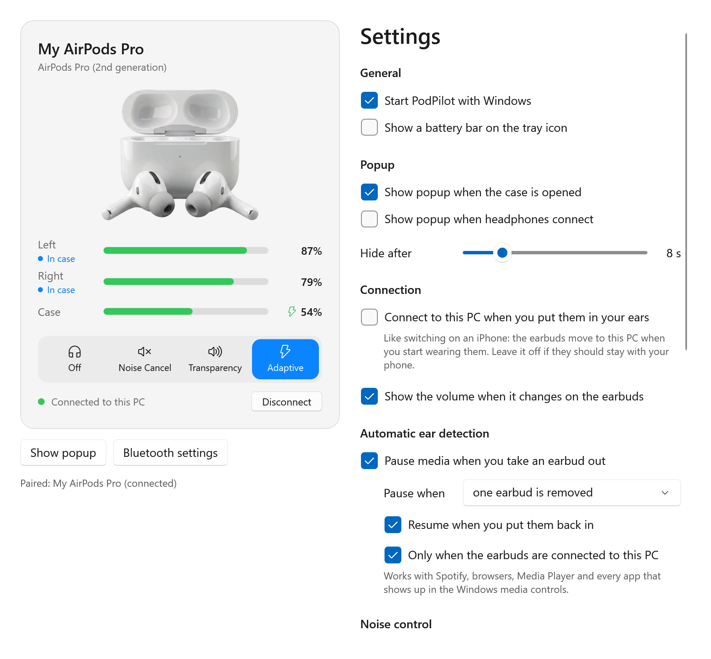
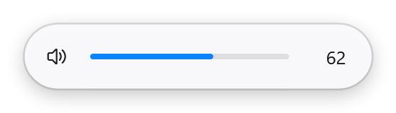
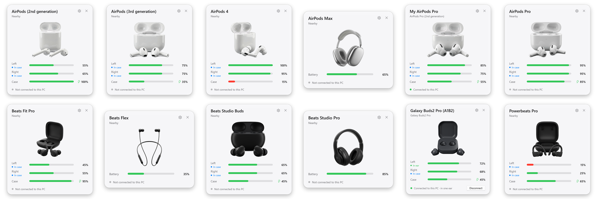

<p align="center">
  
</p>

<h1 align="center">Earlo</h1>

<p align="center">
  <b>Your AirPods, Beats and Galaxy Buds, finally at home on Windows.</b><br>
  The iPhone battery popup for Windows 10 and 11: live battery levels, automatic ear detection, noise control and one-click connect.<br>
  Free, open source, no account, no telemetry.
</p>

<p align="center">
  <a href="../../releases/latest"></a>
  <a href="../../releases"></a>
  
  <a href="LICENSE"></a>
  <a href="https://kylianxdev.github.io/Earlo/"></a>
</p>

<p align="center">
  
  
  
</p>

> **Earlo was called PodPilot** until version 0.4. The GitHub version updates itself to Earlo and keeps your settings;
> the Store version keeps updating through the Store.

## Why Earlo

Windows treats your AirPods like any other Bluetooth headset: no battery levels, no popup, no ear detection.
Earlo brings back what you are used to from an iPhone, and adds the things Windows forgot.

### See everything at a glance

- **Popup when you open the case**, just like on an iPhone: your earbuds, the case, charging state, in a clean Windows 11 card.
- **"Connected" notice** in the top right corner when your earbuds connect, with their battery levels. It disappears by itself.
- **Every earbud, live**: in your ear, out of your ear or in the case, with its own battery level.
- **Battery in the tray**: hover the icon for every level, or turn on the small battery bar on the icon itself.
- **Low battery warnings** for each earbud and the case, before your music cuts out.

### It just works

- **Automatic ear detection**: take an earbud out and Spotify, YouTube, Netflix or any other app pauses. Put it back in and it plays on.
- **Connect in one click** from the popup, or let your earbuds switch to the PC by themselves when you put them in, like on an iPhone.
- **Disconnect in one click**, so your phone can have them back.
- **Stereo sound in every app**: Windows drops AirPods to muffled call quality as soon as an app opens their microphone. One switch turns the earbuds' microphone off, so they always sound like they should (calls then use your PC's microphone).
- **A volume indicator for stem swipes**: Windows changes the volume silently when you swipe; Earlo shows it, like the volume keys do.
- **Noise control** (Off, Noise Cancellation, Transparency, Adaptive) and Conversation Awareness with the [experimental driver](#noise-control-it-works-but-windows-makes-it-hard).

### Made for Windows

- **Lives in the tray**: starts quietly with Windows, click the icon to open it.
- **Pops up next to your taskbar**, wherever it is: bottom, top, left or right, on any monitor and any DPI.
- **English and Dutch**, following your Windows language. Light and dark mode, the Windows 11 look.
- **Updates itself**: the GitHub version installs new releases automatically (verified against their checksums), the Store version updates through the Store.
- **Private by design**: no account, no telemetry, no cloud. The only internet traffic is the update check against GitHub ([privacy policy](PRIVACY.md)).
- **One file**: a single `Earlo.exe`, no installer, no background services.

<p align="center">
  
</p>

<p align="center">
  
</p>

## Supported devices

| AirPods | Beats | Samsung |
| --- | --- | --- |
| AirPods (1st and 2nd generation) | Powerbeats Pro, Powerbeats Pro 2 | Galaxy Buds, Buds+ |
| AirPods (3rd generation) | Beats Fit Pro | Galaxy Buds Live, Buds Pro |
| AirPods 4, AirPods 4 (ANC) | Beats Studio Buds, Studio Buds + | Galaxy Buds2, Buds2 Pro |
| AirPods Pro | Beats Solo Buds | Galaxy Buds FE, Buds Core |
| AirPods Pro (2nd generation, Lightning and USB-C) | Beats Flex, BeatsX, Powerbeats, Powerbeats3 | Galaxy Buds3, Buds3 Pro, Buds3 FE |
| AirPods Pro 3 | Beats Solo3, Solo Pro, Solo 4 | |
| AirPods Max (Lightning and USB-C) | Beats Studio3, Studio Pro | |

<p align="center">
  
</p>

AirPods and Beats released after this version still show their battery levels, as generic headphones.
If that happens, please [open an issue](../../issues) with a diagnostics log (see below) so the model can be added.
Galaxy Buds are read over their own Bluetooth channel, so they need to be paired and connected to your PC;
in return they report exact 1% battery levels.

## Questions

**How do I see my AirPods battery level on Windows?**
Start Earlo and open the AirPods case near your PC. A popup shows the left and right earbud and the case, like on an iPhone,
and the tray icon shows the levels at any time. Pairing is not even needed for the battery levels.

**Does AirPods ear detection work on Windows?**
Yes. Take an earbud out and Earlo pauses Spotify, YouTube, Netflix or any other app in the Windows media controls; put it back in and it plays on.

**Can I switch AirPods noise cancellation on Windows?**
Yes: Off, Noise Cancellation, Transparency and Adaptive, plus Conversation Awareness, with Earlo's
[experimental driver](#noise-control-it-works-but-windows-makes-it-hard).

**Why do my AirPods sound bad on Windows?**
As soon as an app opens the earbuds' microphone (Teams, Discord, Zoom, a browser), Windows switches them from stereo to the Hands-Free profile:
mono and muffled, like a phone call. In Earlo, turn on Settings > Sound quality > "Turn off the earbuds' microphone for the best sound".
They then always play in stereo; the catch is that their microphone no longer works, so calls use your PC's microphone. You can switch it back at any time.

**Does it work with Galaxy Buds and Beats?**
Yes. Beats earbuds and headphones work like AirPods. Galaxy Buds, from the 2019 Buds to the Buds3 Pro and Buds Core,
report exact battery levels once they are connected to your PC.

**Is Earlo free?**
Yes, free and open source here on GitHub. The [Microsoft Store](#microsoft-store) version costs about €1 and funds signing the driver.

## Install

**Microsoft Store** (automatic updates, supports development): see [below](#microsoft-store).

**GitHub** (free):

1. Download from the [latest release](../../releases/latest):
   - `Earlo-win-x64.zip`: standalone, runs on any PC.
   - `Earlo-win-x64-small.zip`: about 9 MB, but needs the [.NET 10 Desktop Runtime](https://dotnet.microsoft.com/download/dotnet/10.0) (Windows offers to install it on first start).
   - `win-arm64` versions for ARM PCs.
2. Unzip it anywhere, for example your Documents folder. It is a single `Earlo.exe`.
3. Run `Earlo.exe`. It lives in the notification area next to the clock (under the `^` arrow); click the icon to open it.

Requirements: Windows 10 version 2004 or newer, or Windows 11, with a Bluetooth 4.0 (LE) adapter.

Pair your earbuds with Windows as usual (Settings > Bluetooth & devices > Add device, then hold the button on the case).
Pairing is optional for AirPods battery levels, but needed for your device name, ear detection, connecting and Galaxy Buds.

## How it works

AirPods and Beats constantly broadcast a small Bluetooth LE message (Apple's "proximity pairing" message, manufacturer data `0x004C`, type `0x07`).
It contains the model, the battery level of each earbud and the case in steps of 10%, charging flags, in-ear sensors and the lid state.
Earlo reads it with the standard Windows Bluetooth APIs. This is the same data your iPhone uses for its popup.

Because the levels come in 10% steps (for example "80 to 89%"), Earlo shows the middle of the range (85%), like MagicPods does.

| Part | File |
| --- | --- |
| Message parser | [`ProximityPairingMessage.cs`](src/Earlo.Core/Protocol/ProximityPairingMessage.cs) |
| Model list | [`DeviceCatalog.cs`](src/Earlo.Core/Devices/DeviceCatalog.cs) |
| Smoothing, device selection, events | [`PodsTracker.cs`](src/Earlo.Core/Tracking/PodsTracker.cs) |
| Bluetooth LE scanning | [`AdvertisementScanner.cs`](src/Earlo.Core/Bluetooth/AdvertisementScanner.cs) |
| Media pause/resume | [`MediaController.cs`](src/Earlo.Core/Media/MediaController.cs) |
| Galaxy Buds protocol | [`GalaxyBudsMessage.cs`](src/Earlo.Core/Samsung/GalaxyBudsMessage.cs) |
| Connect button, volume indicator | [`AudioEndpoints.cs`](src/Earlo.App/Services/AudioEndpoints.cs) |

### Noise control: it works, but Windows makes it hard

Switching noise control (Off, Noise Cancellation, Transparency, Adaptive), Conversation Awareness, Adaptive strength
and exact 1% battery levels need Apple's AAP protocol over a Bluetooth L2CAP channel (PSM `0x1001`).
Windows does not let normal apps open L2CAP channels, so Earlo has its own open-source kernel driver for it: see [`driver/`](driver/README.md).

<p align="center">
  
</p>

**The driver works.** Installing it is the hard part: Windows only loads drivers signed by Microsoft, and this one is not (yet, see below).
On a PC with Secure Boot (almost every modern PC) you have to start Windows with "Disable driver signature enforcement" (F7 in Startup Settings),
and you have to do that again after every restart. The GitHub version of Earlo has an **Install noise control driver** button in Settings
that does the rest for you. Without the driver, everything else in Earlo works as usual.

## Help unlock noise control for everyone

We figured out how to switch AirPods noise control on Windows, the thing people have wanted for years. The driver is written, open source and it works.
The only thing between you and a one-click install is a signature from Microsoft.

To sign a driver, Microsoft requires an EV code signing certificate, and those cost up to **about €700 per year**, every year. Blame Microsoft.
With that signature the driver installs with one click, Secure Boot stays on and it keeps working after a restart. Earlo even switches to the signed driver automatically.

**Want to help?** Get Earlo from the [Microsoft Store](#microsoft-store) for about €1. You get automatic updates through the Store,
and every purchase goes towards the signing certificate. Earlo stays free and open source on GitHub, so it is your choice.

<a id="microsoft-store"></a>
> **Microsoft Store:** in review at Microsoft (submitted October 2026). The link will be here as soon as the listing is live.

| Part | File |
| --- | --- |
| AAP packets and parsing | [`AapPacket.cs`](src/Earlo.Core/Aap/AapPacket.cs), [`AapMessage.cs`](src/Earlo.Core/Aap/AapMessage.cs) |
| Session (handshake, state, commands) | [`AapSession.cs`](src/Earlo.Core/Aap/AapSession.cs) |
| Driver client | [`DriverAapTransport.cs`](src/Earlo.Core/Aap/DriverAapTransport.cs) |
| Kernel driver (KMDF) | [`driver/PodPilotAap`](driver/PodPilotAap) |

## Command-line options

| Option | What it does |
| --- | --- |
| `--minimized` | Still accepted for older autostart entries; Earlo always starts in the tray now. |
| `--demo` | Feed fake AirPods data, to try the app without headphones. |
| `--log <file>` | Write every received AirPods message to a text file. Attach this to bug reports. |
| `--render-preview <folder>` | Render the popup for several models to PNG files. |
| `--lang en` / `--lang nl` | Use English or Dutch instead of the Windows language. |

## Building from source

You need the [.NET 10 SDK](https://dotnet.microsoft.com/download).

```bash
git clone https://github.com/kylianxdev/Earlo.git
cd Earlo
dotnet test
dotnet run --project src/Earlo.App
```

Publish a self-contained build:

```bash
dotnet publish src/Earlo.App -c Release -r win-x64 --self-contained -p:PublishSingleFile=true -o publish
```

## Roadmap

- [x] AAP protocol layer: noise control, Conversation Awareness, exact battery levels
- [x] AAP driver working on real AirPods
- [x] Automatic updates
- [ ] Microsoft Store release (in certification)
- [ ] Sign the driver through Microsoft, so no F7 boot is needed ([help fund it](#help-unlock-noise-control-for-everyone))
- [x] Translations (English, Dutch)
- [x] Samsung Galaxy Buds
- [ ] Installer and winget package

Contributions are welcome. Please open an issue first for larger changes.

## Credits

The AAP byte formats come from the public protocol notes of [LibrePods](https://github.com/kavishdevar/librepods) (no code was copied).
The message format is documented by the reverse-engineering work of the community, including
[OpenPods](https://github.com/adolfintel/OpenPods), [AirPodsDesktop](https://github.com/SpriteOvO/AirPodsDesktop),
[LibrePods](https://github.com/kavishdevar/librepods) and [furiousMAC/continuity](https://github.com/furiousMAC/continuity).
The Galaxy Buds message format is documented by [GalaxyBudsClient](https://github.com/timschneeb/GalaxyBudsClient) (no code was copied).
Earlo is inspired by MagicPods, but shares no code with it.
The AirPods and Beats renders in `src/Earlo.App/Assets/Devices` are AI-generated illustrations, not Apple photos.
The Galaxy Buds renders are 3D models made with [`tools/render-galaxy-buds.py`](tools/render-galaxy-buds.py) (Blender), not Samsung photos.

## License

[MIT](LICENSE). AirPods, AirPods Pro, AirPods Max and Beats are trademarks of Apple Inc. Galaxy Buds is a trademark of Samsung.
Earlo is an independent project and is not affiliated with or endorsed by Apple or Samsung.
