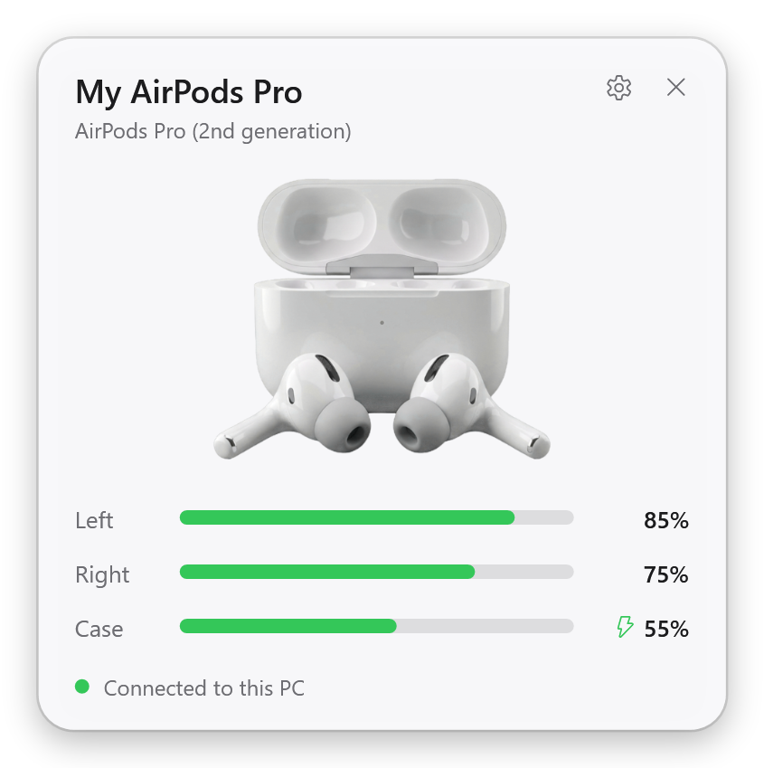

<p align="center">
  
</p>

<h1 align="center">PodPilot</h1>

<p align="center">
  <b>Free, open-source AirPods and Beats companion for Windows.</b><br>
  The iPhone-style battery popup, live battery levels and automatic ear detection, without paying for it.
</p>

<p align="center">
  
</p>

## Features

- **Popup when you open the case**, like on an iPhone: model, left and right earbud, case, charging state.
- **Live battery levels** in the tray icon (the lowest level as a number) and its tooltip.
- **Automatic ear detection**: take an AirPod out and Spotify, YouTube or any other app pauses; put it back in and playback resumes. It works with every app that shows up in the Windows media controls.
- **Low battery warnings** for each earbud and the case.
- **Works with every AirPods and Beats model** (see below). Models released after this version still show their battery levels.
- **Your own device name** ("My AirPods Pro") when the headphones are paired with your PC.
- Starts with Windows, follows light and dark mode, uses the Windows 11 look.
- **No drivers, no account, no telemetry, no internet.** It only listens to Bluetooth LE broadcasts.

## Supported devices

| AirPods | Beats |
| --- | --- |
| AirPods (1st and 2nd generation) | Powerbeats Pro, Powerbeats Pro 2 |
| AirPods (3rd generation) | Beats Fit Pro |
| AirPods 4, AirPods 4 (ANC) | Beats Studio Buds, Studio Buds + |
| AirPods Pro | Beats Solo Buds |
| AirPods Pro (2nd generation, Lightning and USB-C) | Beats Flex, BeatsX, Powerbeats, Powerbeats3 |
| AirPods Pro 3 | Beats Solo3, Solo Pro, Solo 4 |
| AirPods Max (Lightning and USB-C) | Beats Studio3, Studio Pro |

<p align="center">
  
</p>

A model that is not in the list is shown as generic headphones, with working battery levels.
If that happens, please [open an issue](../../issues) with a diagnostics log (see below) so it can be added.

## Install

1. Download `PodPilot-win-x64.zip` (or `win-arm64`) from the [latest release](../../releases/latest).
2. Unzip it anywhere, for example `C:\Program Files\PodPilot` or your Documents folder.
3. Run `PodPilot.exe`. It sits in the notification area (next to the clock).

Requirements: Windows 10 version 2004 or newer, or Windows 11, with a Bluetooth 4.0 (LE) adapter.
The release is self-contained, so you do not need to install .NET.

Pair your AirPods with Windows as usual (Settings > Bluetooth & devices > Add device, then hold the button on the case).
Pairing is optional for battery levels, but needed for your device name and for ear detection.

## How it works

AirPods and Beats constantly broadcast a small Bluetooth LE message (Apple's "proximity pairing" message, manufacturer data `0x004C`, type `0x07`).
It contains the model, the battery level of each earbud and the case in steps of 10%, charging flags, in-ear sensors and the lid state.
PodPilot reads it with the standard Windows Bluetooth APIs. This is the same data your iPhone uses for its popup.

Because the levels come in 10% steps (for example "80 to 89%"), PodPilot shows the middle of the range (85%), like MagicPods does.

| Part | File |
| --- | --- |
| Message parser | [`ProximityPairingMessage.cs`](src/PodPilot.Core/Protocol/ProximityPairingMessage.cs) |
| Model list | [`DeviceCatalog.cs`](src/PodPilot.Core/Devices/DeviceCatalog.cs) |
| Smoothing, device selection, events | [`PodsTracker.cs`](src/PodPilot.Core/Tracking/PodsTracker.cs) |
| Bluetooth LE scanning | [`AdvertisementScanner.cs`](src/PodPilot.Core/Bluetooth/AdvertisementScanner.cs) |
| Media pause/resume | [`MediaController.cs`](src/PodPilot.Core/Media/MediaController.cs) |

### Limitations

Switching noise control (ANC, Transparency, Adaptive), Conversation Awareness and 1% battery precision need Apple's AAP protocol over a Bluetooth L2CAP channel.
Windows does not let normal apps open L2CAP channels, so this needs a kernel driver. That is on the roadmap but not in this version.

## Command-line options

| Option | What it does |
| --- | --- |
| `--minimized` | Start in the tray without opening the settings window (used for autostart). |
| `--demo` | Feed fake AirPods data, to try the app without headphones. |
| `--log <file>` | Write every received AirPods message to a text file. Attach this to bug reports. |
| `--render-preview <folder>` | Render the popup for several models to PNG files. |

## Building from source

You need the [.NET 10 SDK](https://dotnet.microsoft.com/download).

```bash
git clone https://github.com/kylianxdev/PodPilot.git
cd PodPilot
dotnet test
dotnet run --project src/PodPilot.App
```

Publish a self-contained build:

```bash
dotnet publish src/PodPilot.App -c Release -r win-x64 --self-contained -p:PublishSingleFile=true -o publish
```

## Roadmap

- [ ] Noise control and Conversation Awareness (needs an L2CAP driver)
- [ ] Exact 1% battery levels
- [ ] Translations
- [ ] Installer and winget package

Contributions are welcome. Please open an issue first for larger changes.

## Credits

The message format is documented by the reverse-engineering work of the community, including
[OpenPods](https://github.com/adolfintel/OpenPods), [AirPodsDesktop](https://github.com/SpriteOvO/AirPodsDesktop),
[LibrePods](https://github.com/kavishdevar/librepods) and [furiousMAC/continuity](https://github.com/furiousMAC/continuity).
PodPilot is inspired by MagicPods, but shares no code with it.
The product renders in `src/PodPilot.App/Assets/Devices` are AI-generated illustrations, not Apple photos.

## License

[MIT](LICENSE). AirPods, AirPods Pro, AirPods Max and Beats are trademarks of Apple Inc.
PodPilot is an independent project and is not affiliated with or endorsed by Apple.
